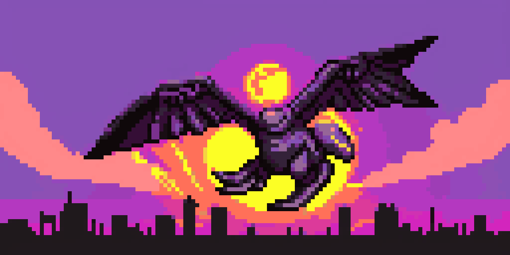

# Dark Inc.

Dark Inc. makes Bevy crates that work alone or together. The Dark Factory is the editor where you and the Night Shift build a game's world, and it ships a blueprint your game loads.

> ⚠️ **Vibe Coded.** Written by AI agents working from a human's direction, covered by tests rather than a line-by-line human review. Read the code before you rely on it for something you care about.

## Lights out

A lights-out factory runs in the dark because the machines do the work. The person writes the order and inspects what comes out. In the Dark Factory a person sets direction, the Night Shift runs the same named operations (work orders) over MCP, and the operation log records every change.

|Word|What it is|
|---|---|
|**Dark Inc.**|the family of crates. Each one is a Bevy plugin with its own settings, and works on its own: a sky, a forest, a crowd, a dialog box.|
|**Dark Factory**|the editor ([bevy_dark_factory](with-dark-factory.md)), where you and the Night Shift place pieces and the learned grammar fills in more.|
|**the Night Shift**|agents working in the Dark Factory over its MCP server (`dark_factory_mcp`).|
|**blueprint**|what a game loads: a library of pieces, maps, and the grammar learned from an authored example ([bevy_blueprint](crates/bevy_blueprint.md)).|
|**work order**|a word for *operation* in these pages; the code says `operation`.|

## The factory floor, in Bevy's words

The code and the editor say Bevy's own words. The factory is a way to remember them:

|Factory|Bevy|
|---|---|
|machine|`Plugin` (usually one crate)|
|machine plate|the API every crate presents: one entry plugin, one root system set, reflected settings and components|
|line|`Schedule`|
|station|`System` (works on every workpiece that has the right parts: a query)|
|workpiece|`Entity`|
|part|`Component`|
|stockroom|`Resource` and assets|

Install machines (plugins) on the floor; the line (schedule) runs every station (system) over every workpiece (entity) by the parts (components) it carries.

Two more helpers belong to the same story: [bevy_fairy](crates/bevy_fairy.md), which lets an agent read and drive a running game, and golem, which drives Blender to make meshes.

## How the crates relate

- Every crate stands alone: add it with `cargo add` and its plugin with `app.add_plugins(...)`. See [Using a crate on its own](alone.md).
- The Dark Factory hosts each crate as an optional cargo feature and edits that crate's own settings live, in your game's project. See [Using a crate in the Dark Factory](with-dark-factory.md).
- Some crates use each other. `bevy_society` speaks through `bevy_speech_bubbles`, steers its walkers with `bevy_orca` and leaves marks with `bevy_stigmergy`.

The [floor plan of Dark Inc.](map.md) shows every crate, grouped by what it gives a game.
